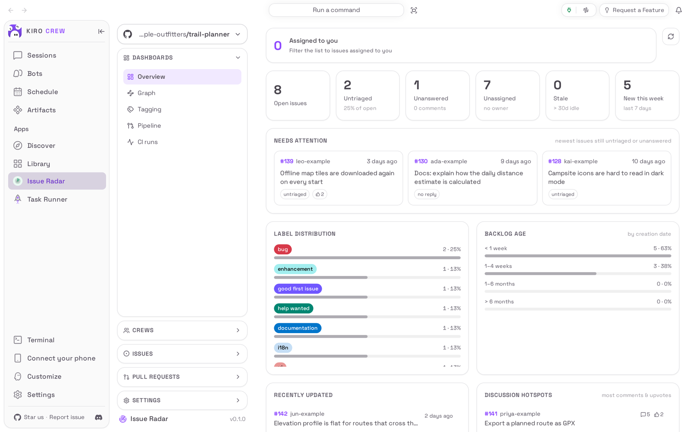
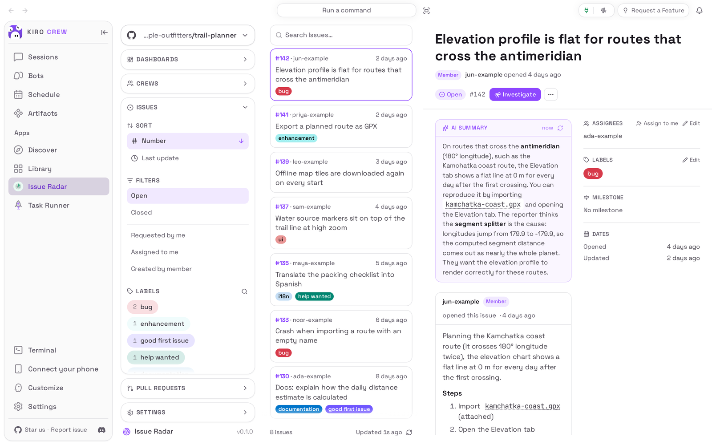
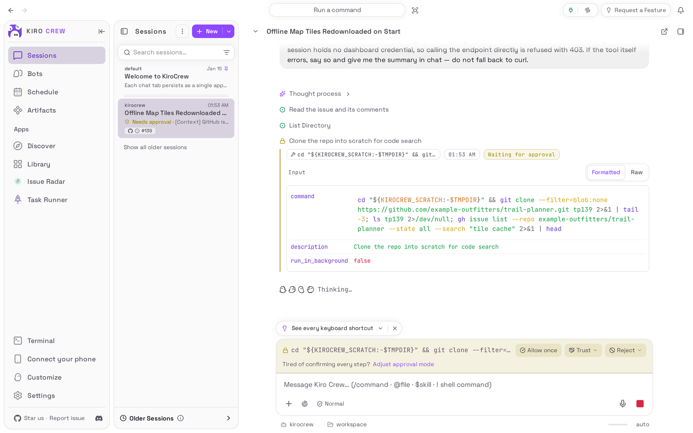

# Issue Radar

<picture>
  <source media="(prefers-color-scheme: dark)" srcset="docs/media/hero-dark.png">
  
</picture>

**Triage your repository's issues and pull requests in one place, with AI help that remembers.**

Issue Radar is an app for [Kiro Crew](https://github.com/kirodotdev/KiroCrew),
the open-source personal AI agent.

## What it is

Issue Radar adds an **Issue Radar** page to Kiro Crew's sidebar. Connect a
GitHub, GitLab or Azure DevOps repository and the page shows an overview of what
needs attention, a list of issues and pull requests with filters, and the full
conversation of whichever one you open. Each item gets a short AI summary, and an
issue gets suggested labels; you can label, assign, close, comment, review and
merge from the same page, or hand an issue to an agent to investigate.

**Get started:** Open **Apps → Discover**, find **Issue Radar**, choose
**Install**, trust it, then **Enable** (details under [Install](#install)).

## The problem it solves

You look after a repository, and the issues and pull requests pile up faster
than you can read them. Working out which ones are new, which nobody has
answered and which change is ready to merge means opening the website, reading
long threads and remembering what you already looked at. Issue Radar puts that
in one page: it sorts the work into what needs you, gives every item a plain
summary you only pay for once, and keeps your notes about an issue so nothing
gets investigated twice. It works through the command-line tool you already use
for that service (`gh`, `glab` or `az`), so it never asks for a password or a
token of its own.

## Top 3 use cases

### 1. Triage a new issue in a minute

A bug report arrives with a long description. You open **Issues**, click it, and
read the **AI summary** at the top instead of the whole thread: what the reporter
saw, how to reproduce it and what they think the cause is. Under **Labels** the
app may offer **Suggested** labels with a reason for each; choose one to add it.
The summary is kept, so opening the issue again later costs nothing.



### 2. Review and merge a pull request without leaving Kiro Crew

A teammate's fix is waiting. Under **Pull Requests** you open it and see its
**AI summary** (what changed and what reviewers have said so far), its **Auto
review** checks, its reviewers, branches and size. When it looks right, choose
**Approve**, then **Merge**. Merging never skips your repository's own rules: if
required reviews or checks are missing, the service refuses the merge, and an
approval or merge is pinned to the commit you were shown, so a push that lands
while you read is refused rather than approved unseen.


### 3. Hand an issue to an agent to investigate

An issue needs real digging. Choose **Investigate** on it: Kiro Crew opens a new
chat with an investigation prompt for that issue already written in the message
box, and you press **Send**. The agent reads the issue, asks your permission
before it runs each command, and records its verdict, root cause and suggested
labels back on the issue, where Issue Radar shows them next time. Choosing
**Investigate** again on a finished issue does not quietly start over: it says
**Already finished — transcript under Older Sessions.**, with **Open Older
Sessions** and **Start over**.

Two limits to know. Issue Radar does not file the chat into a folder or give it
a title: it appears in your chat list like any chat you start yourself. And it
does not keep track of an investigation that is still going, so choosing
**Investigate** (or **Review**) again before that work is finished opens a
second new chat rather than taking you back to the first one; go back to the
first one from your chat list instead.



## Watch it


[Watch the walkthrough as a video (MP4)](docs/media/walkthrough.mp4).

<sub>Recorded from a real Kiro Crew (55439d8770, with its own built-in copy of
this app switched off) on a throwaway home, showing this repository's copy of
the app. The repository, its issues, pull requests and every person in them are
made up, served by a stand-in for `gh` (no real repository or account was used).
The AI summaries and the agent's steps came from a live model and will differ
from run to run; waits for the model were shortened.</sub>

## Install

**From the Kiro Crew App Store**

1. In Kiro Crew, open **Apps → Discover** in the left sidebar.
2. Search for **Issue Radar** and choose **Install**.
3. Kiro Crew asks **Trust “Issue Radar” to run its own code?** The app runs its
   own code inside Kiro Crew to talk to `gh`, `glab` or `az` and to keep its
   notes. Trusting it gives that code the same access Kiro Crew has (your files,
   your saved sign-ins and the internet), as the dialog says. Choose **Trust this
   app**. You can take it back later in **Settings → Security → Third-party
   apps**.
4. The app installs switched off. Choose **Enable** on its page. It then shows
   up under **Apps** in the sidebar and in **Apps → Library**.

**While your Kiro Crew still ships Issue Radar built in.** Every Kiro Crew
release so far includes its own built-in Issue Radar, and installing this copy
under the same name is refused (`app 'issue-radar' is already installed`), from
the App Store and from `kirocrew app install` alike. You keep using the built-in
copy, and nothing here changes it. This copy can be installed once you run a Kiro
Crew release that no longer ships the built-in, or that moves the built-in onto
this source; until then the steps below do not apply to you.

You need Kiro Crew 0.13.0 or later, on macOS, Linux or Windows, and the
command-line tool for the service you connect, signed in on the computer Kiro
Crew runs on: **GitHub CLI** (`gh auth login`) for GitHub, **GitLab CLI**
(`glab auth login`) for GitLab, or the **Azure CLI** with its DevOps extension
(`az login`) for Azure DevOps. The AI summaries and investigations use the same
AI model your chats use: if ordinary chats work, these work.

## First run

The first time you open **Issue Radar** it shows a short welcome ending in
**Let's Connect a Repo**. Choose the service, then either tick repositories you
have recently worked on or paste a repository's web address, and choose
**Connect**. Later you add more with **Connect repo** under **Settings** in the
left column. If the service's command-line tool is not signed in yet, the panel
shows the exact sign-in command to run. Once connected, the page opens on the
repository's **Overview**.

## How to use it

1. Open **Issue Radar** in the sidebar. The **Overview** shows open, untriaged,
   unanswered, unassigned and stale issues and a **Needs attention** list.
2. Open **Issues** (or **Pull Requests**) in the left column, narrow the list
   with the **Filters** and **Labels**, and click an item to open it.
3. Read the **AI summary**. To change labels, choose **Edit** next to
   **Labels**, or a **Suggested** label; to assign, choose **Assign to me** or
   **Edit** next to **Assignees**; to reply, use the comment box under
   **Timeline**.
4. On a pull request, use **Approve**, **Request changes**, **Comment**,
   **Merge** or **Close**. Tick several pull requests in the list to act on all
   of them at once.
5. Choose **Investigate** on an issue (or **Review** on a pull request) to hand it
   to an agent, then **Send** in the chat that opens. The chat is not put in a
   folder or titled for you, and choosing **Investigate** or **Review** again
   while that work is unfinished opens another new chat: return to the first
   one from your chat list.
6. Switch repositories with the repository picker at the top left; open
   **Settings** there to choose which labels mean "needs triage", turn on
   notifications for new issues or for failed checks on your own pull requests,
   and tell investigations which folder holds your copy of the code.

## Settings & data

- **Where your data lives:** `~/.kiro/crew/apps/issue-radar/data/` (or under
  `$KIROCREW_HOME` if you set it): your connected repositories and settings,
  copies of the lists and items it last fetched, the AI summaries and your
  investigation notes.
- **What leaves your computer:** Issue Radar reads and writes your repositories
  through `gh`, `glab` or `az`, so those requests go to GitHub, GitLab or Azure
  DevOps with your own sign-in. An AI summary, a label suggestion or an
  investigation sends the item's text to the AI model your chats use.
- **Turn it off:** **Apps → Library**, open the **⋯** menu on Issue Radar, choose
  **Disable**. Your data is kept.
- **Remove it:** the same menu, **Uninstall**. **Keep app data** is ticked by
  default; untick it to delete the data too.

## Troubleshooting / FAQ

**Connecting a repository says I need to sign in.**
Issue Radar uses the service's own command-line tool. Run the sign-in command the
panel shows (for example `gh auth login`) on the computer Kiro Crew runs on, then
choose **Connect** again.

**The edit buttons are missing, or a change is refused.**
Writing needs at least triage access on the repository. With read-only access
the page says **Connected read-only — triage or push access is needed to act**:
it still shows everything and suggests labels, but does not change anything.

**A self-hosted GitLab is not offered.**
Only gitlab.com and the GitLab addresses your Kiro Crew is set up to allow can
be connected. Ask whoever runs your Kiro Crew to add the address.

**Investigate opened a chat but nothing happened.**
The prompt is placed in the message box for you to read first: press **Send**.
The agent asks before each command it runs; choose **Allow once** to let it
continue.

**Choosing Investigate again opened a second chat.**
Issue Radar cannot yet return you to a chat it opened, so a repeat
**Investigate** or **Review** on an item whose work is not finished starts a new
chat. Close the extra one and carry on in the first, which is in your chat list.
Once the work is finished, **Investigate** says **Already finished — transcript
under Older Sessions.** instead.

**Does Issue Radar run crews on its own?**
You can set up **Crews**, agents that work through issues for you. In this
version a crew does not run on its own (**Run unattended**): unattended work
needs a permission Kiro Crew does not yet give apps, so such a crew waits rather
than acting without you. Investigations and reviews you start yourself work as
described above.

**Merge was refused.**
The service enforces your repository's rules. The page shows the reason (for
example a required review or check is missing); fix that, or choose
**Auto-merge** (GitHub and Azure DevOps) so the change lands by itself once the
rules pass.

## Development

The backend is `backend/` (loaded by the gateway through `backend.hooks` in
`app.json`); the page is `ui/src/`, built into the committed `ui/dist/index.mjs`.
How this repository was ported from Kiro Crew's built-in app, and what is still
missing, is in [PORTING.md](PORTING.md).

### Install from a clone

```bash
git clone https://github.com/KiroCrewCaptain/kirocrew-app-issue-radar
kirocrew app install ./kirocrew-app-issue-radar
kirocrew app enable issue-radar
```

`kirocrew app enable` is refused with `app_execution_denied` until the app is
trusted, and there is no command-line trust step. Enable it from **Apps →
Library** instead: that opens the trust dialog, and **Trust this app and
enable** does both. `kirocrew app disable issue-radar` turns it off;
`kirocrew app uninstall issue-radar` keeps the data and adding `--purge-data`
deletes it.

### Tests

```bash
python -m pip install -r tests/requirements.txt
python -m pytest -n 4
cd ui && npm ci && npm test && npm run build   # the build must leave ui/dist unchanged
```

### Re-capture the README media

The pictures and the recording come from a real, isolated Kiro Crew gateway
driven by [`capture/`](capture/README.md), with a stand-in `gh` serving the
fictional repository. After any change to what the app shows:

```bash
KIROCREW_GH_BIN=$PWD/capture/fake_gh/gh PATH=$PWD/capture/fake_gh:$PATH \
  python capture/capture.py --kirocrew /path/to/KiroCrew
python capture/check_readme.py
```

Then look at every image and at a few frames of the video before committing
(see [CHECKLIST.md](CHECKLIST.md)).

## License

Apache License 2.0. See [LICENSE](LICENSE) and [NOTICE](NOTICE).
